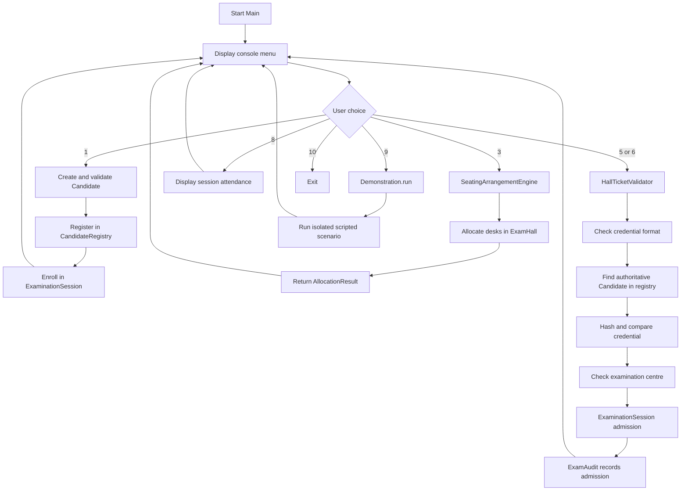

# System Architecture

## 1. Overview

Project 37 is a single-process, single-user Java console application. It uses standard Java classes and in-memory collections. There is no database, network service, GUI framework, or external Java dependency.

The design separates the command-line interface, candidate model, registration, seating, ticket validation, session workflow, and audit reporting.

## 2. Main components

| Component | Responsibility | Source |
|---|---|---|
| Console entry point | Displays the menu, reads input, and dispatches menu actions | `src/Main.java` |
| Candidate model | Stores validated candidate information and assigned desk | `src/Candidate.java` |
| Candidate registry | Stores candidates and looks them up by USN; rejects duplicates | `src/CandidateRegistry.java` |
| Examination hall | Represents the hall dimensions and `Candidate[][]` seating matrix | `src/ExamHall.java` |
| Seating engine | Performs checkerboard allocation and optional least-conflict fallback | `src/SeatingArrangementEngine.java` |
| Allocation result | Reports seated/unallocated candidates and adjacency counts | `src/AllocationResult.java` |
| Ticket validator | Validates credential format, registration, hash, and centre | `src/HallTicketValidator.java` |
| Custom exceptions | Represents invalid hall tickets and wrong examination centre | `src/InvalidHallTicketException.java`, `src/WrongExamCenterException.java` |
| Session workflow | Enrols and admits candidates, finalises a session, and builds reports | `src/ExaminationSession.java` |
| Audit | Stores per-session USN sets and aggregate static counters | `src/ExamAudit.java` |
| Admission outcome | Enumerates possible admission results | `src/AdmissionResult.java` |
| Scripted demonstration | Runs a self-contained example without changing the live menu's objects | `src/Demonstration.java` |
| Test runner | Runs dependency-free checks against the project classes | `test/TestRunner.java` |

## 3. Runtime flow



The menu has 10 choices. Option 9 calls `Demonstration.run()`. The demonstration creates its own registry, hall, session, seating engine, and validator; it does not use the live menu's static objects.

## 4. Seating algorithm

The hall is represented by a two-dimensional array. For a desk at row `r` and column `c`, the parity of `r + c` determines which department queue is selected:

- Even parity desks are assigned from one department queue.
- Odd parity desks are assigned from the other department queue.
- Horizontal and vertical neighbours have opposite parity, so the first pass separates the two departments.

The larger department is assigned to the even-parity desks because a rectangular checkerboard has at least as many even-parity cells as odd-parity cells.

If candidates remain after the strict pass:
- In fallback mode, each remaining candidate is placed in the empty desk with the fewest same-department neighbours. The result reports the number of adjacency conflicts.
- In strict mode, fallback is disabled and the remaining candidates are reported as unallocated.

The engine does not constrain diagonal neighbours. When the hall is full, remaining candidates are returned in `AllocationResult`; they are not silently discarded.

## 5. Ticket validation flow

`HallTicketValidator.validateEntry(...)` performs these checks in order:

1. Validate the presented credential's format.
2. Find the candidate by USN in `CandidateRegistry`.
3. Hash the presented credential using SHA-256.
4. Compare the hash with the stored hash using `MessageDigest.isEqual`.
5. Check that the requested centre matches the candidate's assigned centre.
6. Return the authoritative `Candidate` object from the registry.

The order matters: the centre check occurs after credential verification. Invalid-ticket conditions use `InvalidHallTicketException`; a valid candidate at a different centre causes `WrongExamCenterException`.

The console simulates a scan by accepting typed credential text. No physical QR/barcode scanner is implemented.

## 6. Admission and audit flow

`ExaminationSession` coordinates enrolment and admission for one session. It delegates registration/admission facts to `ExamAudit`, which stores a record for each session. Each record contains sets of registered and admitted USNs, a finalisation flag, and the absentee count.

Set membership prevents repeated registration or admission from increasing the totals. Finalisation calculates:

```text
absentees = max(0, registered candidates - admitted candidates)
```

The result is stored so repeated finalisation does not count absentees again. Static aggregate counters represent totals across the in-memory sessions.

`ExamAudit` is explicitly not thread-safe. The current application is single-threaded.

## 7. Data and security boundaries

- All candidate and audit information is held in memory; it is lost when the application exits.
- Only a SHA-256 hash of the hall-ticket credential is stored in `Candidate`.
- SHA-256 alone is not a production ticket-authentication solution. Production use would require high-entropy credentials, keyed or signed verification, replay protection, rate limiting, and secure transport.
- The demonstration uses synthetic candidate details and synthetic credentials.

## 8. Known limitations

- Console-only interface.
- One hall per session in the current workflow.
- Two configured departments in the seating engine.
- Greedy fallback rather than an optimal solver.
- Diagonal adjacency is not constrained.
- No persistent database or real scanner integration.
- No multithreading; shared audit structures are not thread-safe.
