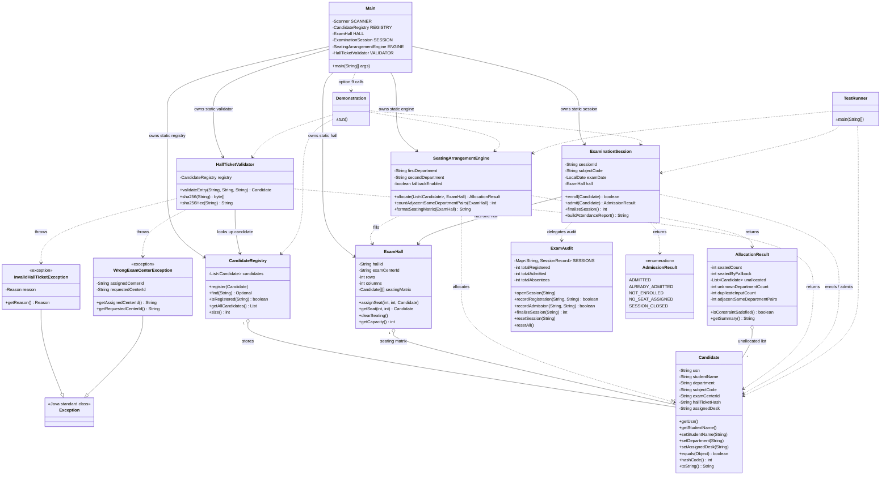

# Class Diagram

The Mermaid class diagram below documents classes and relationships present in the Java source. The project does not declare any interfaces, so none are shown.

## Relationship notes

- `CandidateRegistry` stores a list of `Candidate` objects.
- `ExamHall` stores candidates in its two-dimensional seating matrix.
- `SeatingArrangementEngine` operates on candidates and an `ExamHall`, then returns an `AllocationResult`.
- `HallTicketValidator` depends on `CandidateRegistry` and returns the registered `Candidate`; it can throw the two custom checked exceptions.
- `ExaminationSession` has an `ExamHall` and delegates registration/admission accounting to static methods in `ExamAudit`.
- Both custom exceptions inherit from Java's `Exception`.
- `AdmissionResult` is an enum, not an exception.
- There are no user-defined interfaces in the source.
